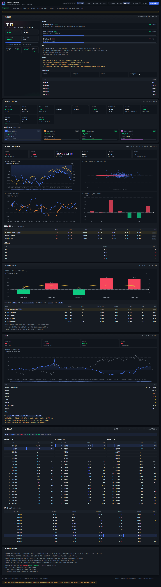

# 中信期货 · 股指期货持仓分析看板

> 抓取中金所每日公布的**中信期货**在 IF / IH / IC / IM 四个股指期货品种上的多空持仓，
> 与沪深300、上证50、中证500、中证1000 指数做拟合，量化「主力空头净持仓变化 → 次日指数收益」
> 的关系，并给出一张**次日行情概率研判卡**。

**一句话结论**：这是一个"概率参考工具"，不是赚钱机器。用 2022-01 至 2026-10 的真实数据实测：
单因子线性解释力很弱（|corr| ≤ 0.14、R² 普遍 < 2%），四品种 × 四窗口共 16 个组合中
**只有 1 个名义显著、多重检验校正后 0 个显著**；按契约规则回测 16 个组合平均年化 −1.88%。
**任何情况下都不能作为实际交易依据。**

---

## 一、快速开始

### 方式 A：一键脚本（Windows）

```powershell
cd D:\Code\Future-Stock-Combine
.\run.ps1
```

脚本会自动：找 Python 3.10+ → 检查依赖 → 库为空时先抓全量数据 → 起服务 → 打开浏览器。

```powershell
.\run.ps1 -Check          # 只做离线自检
.\run.ps1 -Sync           # 先增量同步再启动
.\run.ps1 -Port 9000      # 换端口
```

> 如果 PowerShell 提示"禁止运行脚本"，先执行一次：
> `Set-ExecutionPolicy -Scope CurrentUser RemoteSigned`

### 方式 B：手工命令

```powershell
python app.py --sync --open     # 首次：同步数据 + 启动 + 打开浏览器
python app.py                   # 之后每次直接启动
python app.py --sync            # 只增量更新数据
python app.py --check           # 自检（模块/数据库/全部接口/前端文件）
```

浏览器打开 <http://127.0.0.1:8788/>。端口被占用会自动往后找空闲端口。

### 依赖

只需要 **Python 3.10+** 和 `numpy`、`pandas`：

```powershell
python -m pip install -r requirements.txt
```

Web 服务用标准库 `http.server`，抓取用标准库 `urllib`，存储用 `sqlite3`，
**没有 Flask / FastAPI / requests 等额外依赖**，离线也能跑。

---

## 二、数据来源

| 数据 | 来源 | 说明 |
| --- | --- | --- |
| 中信期货多空持仓 | 中金所《成交持仓排名》 `cffex.com.cn/sj/ccpm/` | 每日收盘后公布，含当日结算后前 20 名会员的持买单量/持卖单量；GBK 编码 |
| 期货合约收盘/持仓量 | 中金所日行情 `cffex.com.cn/sj/hqsj/rtj/` | 用于计算主力合约、基差、全市场持仓量 |
| 指数日线 | 新浪财经（主）/ 腾讯财经（长历史）/ 东方财富（兜底） | 沪深300 000300、上证50 000016、中证500 000905、中证1000 000852 |

数据区间：`2022-01-03` 起至最新交易日（当前库内 2022-01-04 ~ 2026-10-20，1160 个交易日；
IM 自 2022-07-22 上市）。每次启动或点「立即更新数据」都会**增量**补齐最新交易日。

### 抓取时踩过的坑（已在代码中处理）

1. 中金所 CSV 是 **GBK** 编码，必须 `decode("gbk", "ignore")`。
2. 非交易日 / 未发布时，服务器返回 **HTTP 200 + 2132 字节的 GBK 错误页**（"网页错误"），
   不是 404。必须按返回体长度和内容判定"当日无数据"。
3. 合约代码**右侧补空格**（`IF2611    `），必须 `strip()` 后再入库。
4. 会员名从 **2024-02-26** 起带 `(代客)` 后缀（库内 `kv.member_naming_break_date` 记录该断点），
   早期是裸名、且全角/半角括号并存，需归一化后合并。
5. 2020 年前后存在 `非期货公司` 全 0 行和 9 列残行，解析时跳过。
6. 每日每品种通常 3 个合约（当月/下月/下季），季末可能出现第 4 个，不能写死。
7. 东方财富行情接口有风控，首次成功后会断连，因此只作最后兜底；日常优先新浪。

---

## 三、方法口径（重要）

### 3.1 核心因子

中信期货在**该品种所有合约上**的：

- 持买单量合计 `citic_long`、持卖单量合计 `citic_short`
- **净持仓** `citic_net = citic_long - citic_short`（为负 = 净空）
- **净空单** `short_net = -citic_net`（为正 = 净空）
- 归一化：`citic_net_pct = citic_net / 全市场持仓量 × 100`
- **日变化（主因子）**：`dnet = short_net_t - short_net_{t-1}`，正值 = 今天净空单增加（加空）
- 标准化 `dnet_z`：滚动 252 日 z-score（`min_periods=60`）
- 分位 `dnet_pctile`：滚动 252 日的百分位

### 3.2 拟合

- 目标变量：`y_t = ln(close_{t+1} / close_t) × 100`（**次日**指数对数收益，%）
- 单变量 OLS：`y_t = a + b·x_t + e`，报告 `corr`、`slope`、`R²`、经典 OLS `t` 统计量、
  正态近似 `p` 值；`p < 0.05` 记为显著
- 同时展示：**当期相关**（当日收益 vs 当日持仓变化）、**预测相关**（次日收益 vs 当日持仓变化）、
  领先滞后相关（lag = -3 … +3）、60 日滚动相关、分年度稳定性

### 3.3 分位胜率

按 `dnet_z`（滚动分位）在窗口内切成 5 组：**Q1 = 净空单增加最多**（`dnet_z` 最小）、
Q5 = 净空单减少最多，统计每组**次日**平均收益、中位数、上涨概率、t 检验。
这是"历史条件分布"，不是因果律。

### 3.4 回测

规则写死、不调参：

> 用**滚动 252 日**分位（只用 ≤ t 的数据）：
> 分位 ≤ 20% → 做空；分位 ≥ 80% → 做多；其余空仓。次日收盘结算，换仓计 0.5bp 成本。

结果同时给出净值曲线、年化、最大回撤、夏普、胜率、交易次数、仓位暴露，并与
"买入持有指数"对比。

### 3.5 次日研判卡

把以下证据汇总成研判卡（`backend/signal.py`）：

1. **历史同分位组经验分布**：今日主因子 `dnet_z` 所处分位（滚动 252 日）对应的历史上同期样本，
   给出次日平均收益 `expected_ret_pct`、上涨概率 `up_prob`、样本量 `sample_n`、置信区间。
2. **方向与评分**：`score = clip(expected_ret_pct / 0.3, -1, +1)`（0.3% 约 1/3 个日波动为满刻度）；
   `expected ≥ +0.05%` → 偏多，`≤ -0.05%` → 偏空，其间 → 中性。
3. **置信度**：综合 |expected|、样本量、该分位组均值的 p 值分级（低/中/高）。
4. **驱动因素**：展示 `dnet_z`（净空单日变化标准化）、`net_z`（净持仓水平标准化）、
   `net_pctile`（净持仓历史分位）三项的当前值、z 值、分位与经验斜率，并按 |corr| 加权。
5. **证据 / 风险提示 / 历史相似日**：逐条列出 OLS 与滚动相关结果、单因子解释力、披露时点偏差等。

> ⚠️ **为什么必须强调风险**：这是**滞后披露**数据（T 日晚公布 T 日持仓）、单因子、
> 只覆盖 2022 年以来的 3 年多、且经过了 2024-05 会员口径变更。它的价值在于
> "把主力空头的仓位状态量化成一个可比较的分位数"，而不是预测明天涨跌。

---

## 四、页面结构

| 区块 | 内容 |
| --- | --- |
| 顶部 | 品种 Tabs（IF/IH/IC/IM）、窗口（1年/2年/3年/全部）、数据截止日、「立即更新数据」 |
| 次日研判 | 方向大字、score、上涨概率、预期收益、置信度、驱动证据、风险提示、历史相似日 |
| 持仓总览 | 中信期货多/空/净持仓、净持仓占市场比、今日分位、日变化；四品种横向对比 |
| 拟合分析 | 双轴折线（净持仓 vs 指数）、散点+回归线、60日滚动相关、领先滞后柱状图、年度稳定性 |
| 分位胜率 | 5 组柱状图（平均次日收益 + 胜率）、分组明细表（n / 均值 / 胜率 / p 值） |
| 回测 | 策略净值 vs 指数买入持有、指标卡、免责声明 |
| 会员龙虎榜 | 最新日前 20 名多空持仓（中信期货高亮）、会员横向对比（含预测相关系数） |

界面：纯静态 HTML/CSS/JS + 本地 ECharts 5.6（`frontend/vendor/`，不依赖任何 CDN），深色专业风，
A 股习惯**涨红跌绿**，响应式布局（≥1200px 多列，≤900px 单列）。



---

## 五、HTTP 接口

所有接口返回 `Content-Type: application/json; charset=utf-8`，恒含 `ok` / `error`。

| 接口 | 说明 |
| --- | --- |
| `GET /api/health` | 服务与数据库健康状态、各表行数 |
| `GET /api/meta` | 品种列表、会员列表、数据范围、默认参数、免责声明 |
| `GET /api/dashboard?variety=IF&lookback=720&member=中信期货` | **核心**：快照 + 序列 + 拟合 + 分位 + 回测 + 研判 + 龙虎榜 |
| `GET /api/ranks?date=2026-10-20&variety=IF` | 指定日期多空前 20 名持仓 |
| `GET /api/members?variety=IF&lookback=720` | 各会员净持仓与预测相关系数排名 |
| `GET /api/sync/status` | 后台同步进度 |
| `POST /api/sync` `{"start":"2022-01-03"}` | 触发增量同步 |
| `GET /api/export?variety=IF&lookback=720` | 导出分析用 CSV（带 BOM，Excel 直接打开） |

完整字段定义见 [`contract/API_CONTRACT.md`](contract/API_CONTRACT.md)。

---

## 六、项目结构

```
Future-Stock-Combine/
├─ app.py                  # 启动入口（Web / --sync / --check）
├─ run.ps1                 # Windows 一键脚本
├─ config.py               # 全局配置：品种、会员、URL、窗口、端口
├─ requirements.txt
├─ contract/
│  └─ API_CONTRACT.md      # 前后端接口与统计口径契约
├─ backend/
│  ├─ db.py                # SQLite 表结构 + 连接池 + upsert
│  ├─ http_util.py         # 带重试/退避/UA/GBK 的抓取封装
│  ├─ sources/
│  │  ├─ cffex.py          # 中金所 ccpm（持仓排名）+ hqsj（日行情）
│  │  └─ index_data.py     # 新浪/腾讯/东财 指数日线
│  ├─ sync.py              # 全量/增量同步 + 聚合落库
│  ├─ analytics.py         # 拟合、分位、回测、分类统计
│  ├─ signal.py            # 次日研判引擎
│  └─ api.py               # 路由层（静态资源 + JSON 接口 + 后台同步）
├─ frontend/
│  ├─ index.html / styles.css / app.js
│  ├─ js/                   # util / api / charts / render/* 渲染模块
│  ├─ mock/                 # 离线示例数据（后端未起时自动回退）
│  └─ vendor/echarts.min.js
├─ tools/verify.py          # 契约一致性 + 数值合理性验收脚本
├─ data/market.db          # 运行时生成的 SQLite 库（约 180 MB）
├─ tests/                  # 84 个离线单测（不联网，mock 网络层）
└─ reports/                # 数据同步报告 / 分析结论
```

常用验证命令：

```powershell
python app.py --check        # 自检：导入、库行数、全部接口、前端资源
python tools\verify.py       # 契约验收：四品种 × 四窗口 16 个组合的字段/数值/无 NaN
python -m unittest discover -s tests   # 84 个离线单测
```

---

## 七、研究结论

### 7.1 主因子与次日收益：16 个组合里只有 1 个名义显著

corr(`dnet_z` 净空单日变化, 次日指数收益)，括号为 p 值；`*` = p<0.05：

| 品种 | 1年(240) | 2年(480) | 3年(720) | 全部 |
|---|---|---|---|---|
| IF 沪深300 | **+0.143 (0.026)\*** | +0.042 (0.354) | +0.026 (0.489) | +0.008 (0.784) |
| IH 上证50 | −0.036 (0.578) | −0.008 (0.865) | +0.004 (0.922) | +0.014 (0.638) |
| IC 中证500 | −0.018 (0.780) | −0.055 (0.232) | −0.030 (0.419) | −0.037 (0.225) |
| IM 中证1000 | −0.010 (0.877) | −0.042 (0.359) | +0.023 (0.540) | +0.016 (0.627) |

- 16 个组合只有 **IF·1年** 名义显著（p=0.0263），Bonferroni 校正 0.05/16≈0.0031 下 **0/16 通过**。
- 辅助因子 `net_z`（净持仓水平）与 `net_pctile`（水平分位）**0/16 显著**（|corr| ≤ 0.105）。
- 也就是说：**"中信期货净空单变化 → 次日指数收益"的线性预测力非常弱**（|corr| ≤ 0.14，R² 普遍 < 2%），
  这正是本项目必须把"概率参考、非交易依据"写在最前面的原因。

### 7.2 回测：扣掉成本后不具备可交易的方向性 alpha

契约固定规则（滚动分位 ≤20% 做空 / ≥80% 做多 / 其余空仓、次日收盘结算、单边 0.5bp）：

| 品种（3年窗口） | 年化 | 最大回撤 | 夏普 |
|---|---:|---:|---:|
| IF 沪深300 | **+3.13%** | −31.01% | 0.31 |
| IH 上证50 | −3.96% | −20.34% | −0.29 |
| IC 中证500 | −3.98% | −29.68% | −0.18 |
| IM 中证1000 | +1.27% | −30.06% | 0.16 |

- 16 个组合平均年化 **−1.88%**，仅 5/16 为正；方向反转后 8/16 为正、均值 −1.07%
  —— 说明不是"方向搞反了"就能赚，反向挑选属于事后拟合。
- 结论：**扣 0.5bp 成本后，该因子不具备可交易的方向性 alpha**；回测画面展示的是"这条路走不通"的诚实证据。

### 7.3 最有价值的发现：它更像"行情的结果"，不是"行情的原因"

| 组合 | lag−1 相关（因子 t−1 vs 当日收益 t） | lag 0 预测相关（因子 t vs 次日收益 t+1） |
|---|---:|---:|
| IF·3年 | **+0.164** | +0.026 |
| IC·3年 | **−0.220** | −0.030 |

净空单变化的**同期**相关比**领先一日**的预测相关大一个量级：当天指数上涨 → 中信期货（代客）多头
加仓、空头减仓，反之亦然。**会员持仓变化是对当日行情的反应，而不是领先信号**——这是本数据
最重要的负面结论，也是"拟合优度低"的根本原因。

### 7.4 当日研判（数据日 2026-10-20，目标日 2026-10-21）

| 品种 | 方向 | score | 置信 | 上涨概率 | 预期收益 | 同分位样本 |
|---|---|---:|---|---:|---:|---:|
| IF 沪深300 | 中性 | −0.08 | 低 | 46.2% | −0.024% | n=143 |
| IH 上证50 | 中性 | +0.11 | 低 | 49.0% | +0.032% | n=143 |
| IC 中证500 | 偏空 | −0.18 | 低 | 48.3% | −0.053% | n=143 |
| IM 中证1000 | 偏空 | −0.27 | 中 | 50.3% | −0.082% | n=143 |

> 数字来自 `reports/analytics.md`（真实库、真实数据，未做任何美化）。
> 若某个品种"不显著"，就如实写不显著——这本身就是有用的结论。
> 完整明细（OLS 斜率/R²/t 值、7 种回测变体、年度稳定性、17 条数据告警）见
> [`reports/analytics.md`](reports/analytics.md) 与 [`reports/data_sync.md`](reports/data_sync.md)。

### 7.5 数据事实（2026-10-20 收盘）

中信期货四品种合计**净空 −77,344 手**（全市场 OI 合计 1,196,811 手）：

| 品种 | 主力合约 | 多单 | 空单 | 净持仓 | 成交量榜 |
|---|---|---:|---:|---:|---|
| IF | IF2612 | 31,661 | 56,667 | **−25,006** | 第 1（30,984 手） |
| IH | IH2612 | 14,101 | 23,348 | **−9,247** | 第 1 |
| IC | IC2612 | 50,328 | 59,550 | **−9,222** | 第 1 |
| IM | IM2612 | 70,835 | 104,704 | **−33,869** | 第 1 |

---

## 八、常见问题

**Q：页面打开显示"示例数据"角标？**
A：后端没起来或接口报错，前端自动回退到 mock 数据。先跑 `python app.py --check` 看哪一步失败。

**Q：同步卡在某个日期？**
A：中金所偶发超时，代码有 4 次重试 + 退避；仍失败的日期会记进 `sync_log`，
下次同步自动补抓。也可以 `python app.py --sync --start 2024-01-01` 缩小范围。

**Q：「立即更新数据」会不会重复抓？**
A：不会。同步按已有日期增量，已入库的日期直接跳过（幂等）。

**Q：为什么回测收益不高？**
A：因为本来就不高。这是单因子、低频、样本 3 年多的策略，且中金所披露的是 T 日盘后持仓，
次日开盘已部分反映。工具的意义是**看清主力空头的仓位位置**，不是预测。

**Q：数据能商用吗？**
A：中金所公开披露数据可用于研究；本项目仅作学习研究用途，不构成投资建议。

---

## 九、免责声明

本项目所有输出（包括研判卡的"偏多/偏空"、上涨概率、预期收益、回测指标）
均为**统计描述**，基于历史数据的事后计算，不代表未来表现。
期货与股票交易具有高风险，可能损失全部本金。
**据此入市，风险自担。** 本项目作者不对任何交易损失负责。
